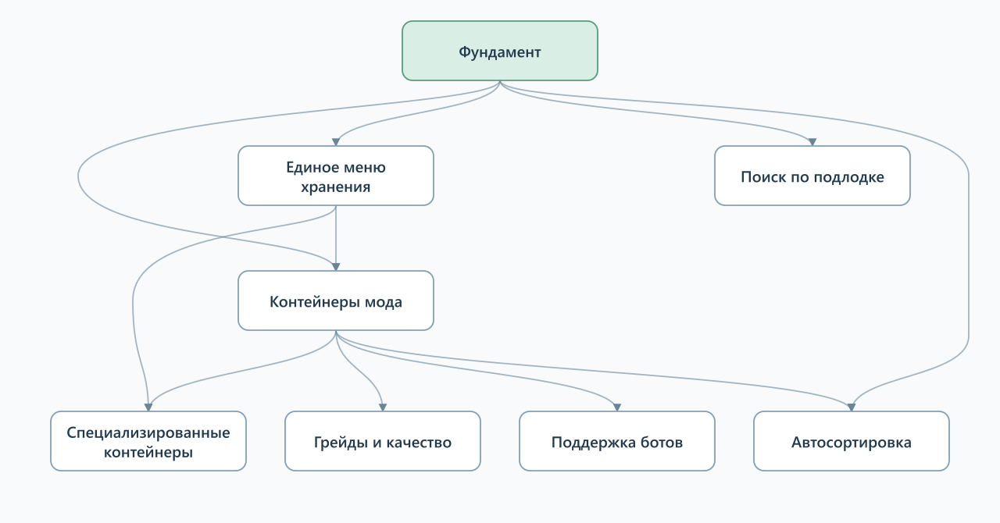

# GDD — Barotrauma Advanced Storage System

Начать с [фундамента](foundation.md): какую проблему решаем и какой опыт хотим дать игроку. Затем читать описание нужной фичи. У каждой фичи своя папка. Начать с её `README.md`: это обзор и навигация к подробным правилам, сценариям и вариантам. Небольшие описания могут оставаться в одном файле.

## Фичи

| Описание | За что отвечает |
| --- | --- |
| [Единое меню хранения](features/storage-menu/README.md) | Списки, поиск, группировка и действия; контексты шкафа и контейнера |
| [Контейнеры мода](features/container/README.md) | Хранение, установка, вместимость, приём и выдача, фильтры |
| [Специализированные контейнеры](features/specializations/README.md) | Типы с ограниченным набором предметов; контейнер для генов и его исследование |
| [Грейды и качество](features/progression/README.md) | Развитие контейнеров и улучшение без выгрузки содержимого |
| [Автосортировка](features/automation/README.md) | Опциональное распределение запаса по подходящим местам |
| [Поддержка ботов](features/bots/README.md) | Размещение и получение вещей ботами с учётом организации хранения |
| [Поиск по подлодке](features/submarine-search/README.md) | Поиск мест хранения за пределами одного шкафа |

## Карта зависимостей

**[Открыть интерактивный граф](assets/graph.html)** — выбрать фичу, увидеть связи и перейти к её описанию.

**A → B: B использует решения A.** Граф не задаёт порядок разработки или состав выпуска. Подробные причины связей — в описаниях фич. [SVG для увеличения](assets/feature-graph.svg).

## С чем работаем сейчас

Основные принципы согласованы; детали фич продолжаем обсуждать. Открытые вопросы находятся рядом с соответствующими темами; вопросы всей фичи — в её обзоре. Принятые правила, исходные замыслы и предложения явно помечены.

Работаем с ванильной игрой и контейнерами нашего мода. Интеграции с другими модами пока не рассматриваем. Состав первого выпуска ещё не утверждён.

Неутверждённый набросок первой версии

Ранее предложен полный цикл «принёс — положил — нашёл — забрал»: базовый переносной контейнер, список с поиском и количеством, общий обзор шкафа, выдача и раскладка по кнопке. Это кандидат для обсуждения, а не принятое обязательство.

При проработке сценария нужно учитывать быстрый доступ, индивидуальные свойства предметов, совместную игру и раннюю проверку взаимодействия ботов с хранением. Грейды, широкий набор специализаций, глобальный поиск и пакетное исследование генов предлагалось прорабатывать после основы; это не решение исключить их из мода.

Критерии первого выпуска выберем после его состава. Численные ориентиры времени и количества действий — после сценариев интерфейса.

## Как поддерживать документацию

[Правила и шаблон GDD](AUTHORING.md). Технические проверки слотов и переноса лежат рядом с [описанием контейнера](features/container/README.md#проверки-ванильной-игры). Все изображения и интерактивный граф общей карты — в `assets/`.
