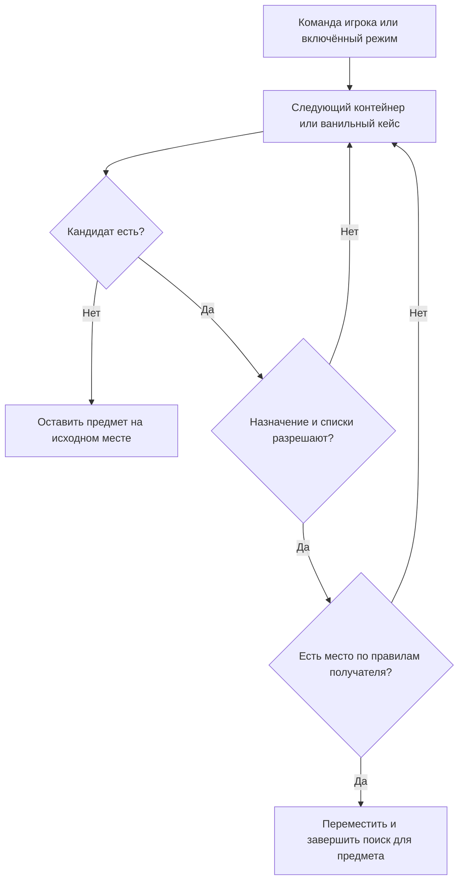

# Автосортировка и автораспределение

[К графу фич](../../README.md) · [Вопросы этой фичи](#открытые-вопросы)

**Статус:** опциональность принята; предложен базовый алгоритм.

## Назначение

Автосортировка, автораспределение и автоскладывание обозначают одну функцию: по запросу игрока система выбирает подходящий контейнер и перемещает туда предмет.

## Сценарий использования

**Опциональность принята; выбор получателя — предложение автора.**

1. Игрок складывает запас в шкаф. Без команды или включённого режима вещи остаются на выбранном месте.
2. Игрок запускает разовую раскладку либо заранее включает постоянную.
3. Система проверяет получателей и переносит предмет в первый подходящий контейнер мода или ванильный кейс.
4. Если допустимого места нет, предмет остаётся в источнике; для партии переносится допустимая часть.

Порядок получателей и точный состав перемещаемого запаса ещё не определены.

## Правила работы

### Граница с обычным размещением

**Принято.** По умолчанию предмет остаётся там, куда его положил игрок. Помещение в слот шкафа не вызывает автоматического переноса в контейнер.

Изменение фильтра само по себе не перемещает и не выбрасывает уже лежащие вещи. [Правила приёма и изменения фильтров](../container/README.md#фильтры).

Разовую раскладку запускает команда игрока. Постоянная раскладка работает только после включения соответствующего режима. Открытие общего меню шкафа не запускает эту функцию.

Алгоритм выбора места относится к отдельной расширяемой фиче. Его можно улучшать по эффективности и гибкости без изменения основ хранения, вместимости и интерфейса. Для фундамента существенны опциональность автоматизации и сохранение обычного ручного размещения.

### Базовый алгоритм

**Предложение автора.** Перемещать предмет в первый доступный контейнер, который может его принять. Получателем может быть контейнер нашего мода или ванильный кейс.

Контейнер подходит, если одновременно выполняются условия:

- Его назначение и ограничения допускают этот предмет.
- Действующие белые и чёрные списки не запрещают размещение. Они обязательны так же, как при ручном помещении.
- Есть доступное место по правилам этого хранилища: общий предел количества для наших контейнеров, обычные слоты и стаки для ванильных кейсов.

Неподходящий или заполненный контейнер пропускается; поиск продолжается. Специальный приоритет наших контейнеров перед ванильными кейсами в этот вариант не заложен.

Пример: при распределении алюминия медицинский контейнер, запрещающий материалы, пропускается. Следующий допустимый контейнер с доступным местом становится получателем.

### Схема выбора

Схема описывает предложенный алгоритм для одного предмета после запроса игрока. Способ определить порядок кандидатов ещё не выбран.

Если подходящего получателя нет, предмет остаётся на месте согласно [общему правилу переноса](../container/README.md#перенос-при-нехватке-места). Допустимая часть партии перемещается, остаток сохраняется в источнике. Показ причины и формат результата ещё предстоит определить.

## Связи с другими фичами

<!-- dependencies:start -->
### Родители

| Родитель | Что используется |
| --- | --- |
| [Фундамент](../../foundation.md) | Выключена по умолчанию, запускается командой или включённым режимом. |
| [Контейнеры мода](../container/README.md) | Учитывает свободную ёмкость наших контейнеров; ванильные кейсы проверяются по своим правилам. Перемещает допустимую часть, оставляет остаток в источнике. Фильтры контейнера: Кандидат должен разрешать приём предмета. |

**Дочерние фичи:** пока не выделены.
<!-- dependencies:end -->

- [Правила размещения](../container/README.md#фильтры)
- [Общий интерфейс](../storage-menu/cabinet.md)
- [Вместимость](../container/README.md#вместимость)
- [Боты](../bots/README.md)

## Открытые вопросы

- Что означает «первый»: порядок слотов или другой понятный и устойчивый порядок?
- Проверяются ли только непосредственно установленные контейнеры или также допустимые вложенные хранилища?
- Раскладываются только предметы из обычных слотов шкафа или также уже разложенное содержимое?
- Как сохранить выбранный быстрый запас при включённой автосортировке? Игрок может оставлять оружие и расходники непосредственно в обычных слотах. Варианты обозначения такого запаса: исключение по типу, закреплённый слот или заданное количество. Решение не выбрано.
- Как показывать итог, остаток и причины отказа?
- Как применяются фильтры на разных уровнях и к ванильным кейсам?

Эти детали относятся к развитию фичи. Область текущего сценария — один шкаф; перенос между шкафами отдельно не утверждён.

Получение предмета ванильным кейсом не добавляет его ёмкость в суммарный счётчик наших контейнеров. [Области списка и счётчика остаются прежними](../container/README.md#вместимость).
