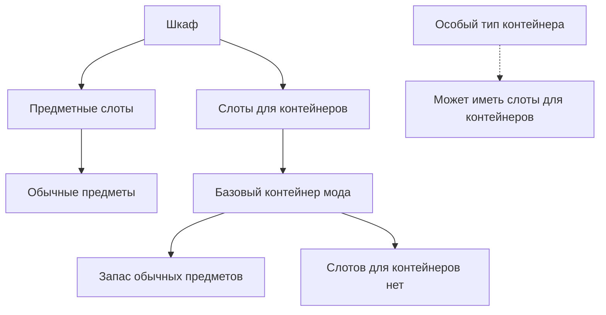
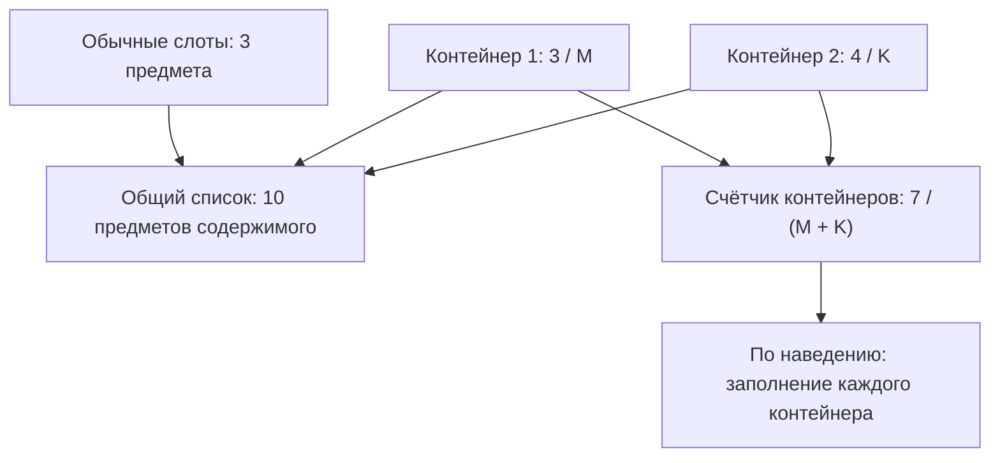
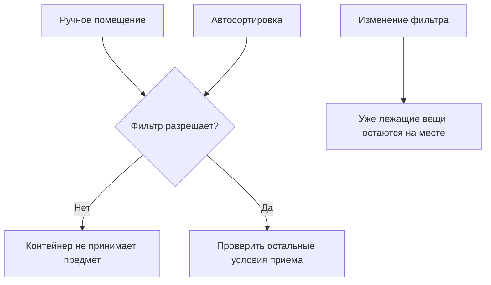

# Базовый универсальный контейнер

[К графу фич](../../README.md) · [Вопросы этой фичи](#открытые-вопросы)

**Статус:** базовые правила приняты; полный сценарий и детали UI прорабатываются.

## Назначение

Дать удобное переносное хранилище со списком и поиском, которое полезно сразу и помещается в знакомую систему шкафов. Универсальный контейнер позволяет начать без предварительной настройки. В документации «контейнер» или «сундук» обозначает переносное хранилище нашего мода; «кейс» — ванильное вложенное хранилище.

## Сценарий использования

**На основе принятых правил.**

1. Игрок помещает контейнер в подходящий слот шкафа.
2. Складывает в него разрешённые предметы; контейнер принимает допустимое количество. Конкретные действия управления ещё выбираются.
3. Наводит указатель на контейнер в слоте и работает с запасом через меню: ищет и получает нужное, не доставая сам контейнер.
4. При необходимости берёт контейнер с собой или добавляет ещё один в свободный подходящий слот.

Рецепты, стоимость и полный сценарий создания контейнера пока не определены.

## Правила работы

### Базовое поведение

**Принято.** Контейнер принимает обычные предметы без специализации по категориям, с соблюдением правил вложенности. Хранение, поиск и простое извлечение через полноценный UI доступны без настройки фильтров и без улучшений.

Контейнер можно использовать самостоятельно и помещать в подходящие шкафы подобно кейсу. Совместимость определяется типом шкафа и предусмотренными местами, а не отдельной настройкой игрока. При нехватке места можно скрафтить ещё один контейнер и поставить его в свободный подходящий слот. Отдельной модернизации шкафа нет.

Контейнер можно взять на вылазку. Целевой опыт переноски соответствует привычным кейсам: неудобство ношения, погружение в воде и невозможность одновременно держать контейнер и пользоваться скутером. Это требования к новому предмету; соответствие конкретной реализации нужно проверить.

### Навигация по описанию

| Поведение | Где описано |
| --- | --- |
| Белые и чёрные списки | [Фильтры](#фильтры) |
| Помещение, получение и нехватка места | [Помещение и извлечение предметов](#помещение-и-извлечение-предметов) |
| Общий предел количества и счётчики | [Вместимость](#вместимость) |
| Открытие, поиск и работа с содержимым | [Меню контейнера](../storage-menu/container.md) |
| Установка и допустимая вложенность | [Слоты и вложенность](#слоты-и-вложенность) |

### Слоты и вложенность

**Принято 20 октября 2026 года.**

- **Предметные слоты** предназначены для обычных предметов.
- **Слоты для контейнеров** предназначены для установки переносных контейнеров и кейсов. Синоним в документации — **слоты расширения**.
- Контейнеры мода размещаются в хранилищах только в предназначенных для них слотах для контейнеров. Это правило о размещении в хранилищах сохраняет принятую возможность нести контейнер в руках.
- У базового контейнера мода слотов для контейнеров нет. Приём других переносных контейнеров и кейсов внутрь базового контейнера запрещён, в том числе через общий список.
- Вложенность может появиться как явно описанная особенность конкретного контейнера. Такие исключения не изменяют базовое правило; конкретные исключения пока не выбраны.
- Общее меню шкафа рекурсивно охватывает всю уже допустимую вложенность. Полнота обзора не разрешает новые способы физического размещения.

Таким образом, «любые вещи» в описании универсального контейнера означает отсутствие специализации по категориям обычных предметов; правило вложенности остаётся в силе.

Сплошные линии показывают базовую модель. Пунктир — разрешённую возможность будущего исключения, а не уже выбранный тип контейнера.

Техническое соответствие: в ванильных шкафах такие дополнительные группы задаются через `SubContainer` и ограничения `mobilecontainer`. Подробности и источники — [справка о ванильных слотах](reference/vanilla-storage-slots.md).

### Вместимость

Механика ограничения запаса и счётчики — часть устройства контейнера. Модель принята; численные значения и детали оформления ещё обсуждаются.

#### Принцип ограничения

**Принято 20 октября 2026 года.** Вместимость контейнера ограничивается общим количеством предметов внутри него. Каждый обычный предмет занимает одну единицу независимо от типа и от того, объединён ли он со своими аналогами в строку или стак.

Счётчик контейнера имеет вид **x / y**:

- **x** — количество находящихся в контейнере предметов.
- **y** — максимальное количество предметов, которое контейнер может вместить.
- **y − x** — свободная ёмкость. Допустимость помещения конкретного предмета также зависит от специализации и правил.

Стак из восьми предметов занимает восемь единиц. Группа «Алюминий — 54» занимает 54 единицы и показывается одной строкой. Это примеры подсчёта, не выбранные лимиты.

Масса, вес и условный объём не используются как единицы вместимости. Собственную систему весов для предметов не вводим. Правила обычных слотов шкафа остаются прежними.

#### Зачем нужен предел

Предел оставляет смысл улучшать существующий контейнер или крафтить дополнительный, если в шкафу есть свободный слот для контейнера. Конкретные значения зависят от грейда и будут подбираться позже так, чтобы оба пути расширения оставались полезными.

По опыту автора, неудобное размещение и нехватка места приводили прежде всего к раздражающему перекладыванию вещей. Цель ограничений мода — поддержать понятное развитие хранения и удобную организацию доступного места.

Отдельная система расширения шкафов не нужна. Контейнеры можно брать на вылазки с привычными неудобствами переноски. Основание: [принятый фундамент](../../foundation.md).

#### Счётчик конкретного контейнера

**Принято.** Меню контейнера показывает его собственное заполнение **x / y**. Функция доступна у базового контейнера.

Объединение предметов по [ванильной совместимости стека](../storage-menu/grouping.md) не изменяет их вклад в заполнение. Численный лимит стака не дробит строки и не заменяет общий предел вместимости. Индивидуальные свойства предметов сохраняются.

#### Суммарный счётчик в меню шкафа

**Принято 20 октября 2026 года.** Суммарный счётчик учитывает только контейнеры нашего мода, работающие с общим пределом количества предметов. Обычные слоты шкафа и ванильные кейсы исключены как из занятого количества, так и из максимальной вместимости:

- Числитель — сумма занятости учитываемых контейнеров.
- Знаменатель — сумма их максимальных вместимостей.
- При наведении на показатель открывается детализация: название каждого учитываемого контейнера нашего мода и его собственное **x / y**.
- Во всплывающем окне явно поясняется: счётчик относится только к контейнерам нашего мода; обычные слоты и ванильные кейсы не учитываются. Точный текст ещё не выбран.
- Общий список и поиск продолжают включать предметы из обычных слотов и ванильных кейсов. Область списка шире области счётчика.
- Название показателя и обозначение подсказки ещё не выбраны. Звёздочка — один из предложенных вариантов.

Пример для двух контейнеров нашего мода:

| Где лежат вещи | Количество | Максимальная вместимость |
| --- | --- | --- |
| Обычные слоты шкафа | 3 | Не входит в счётчик контейнеров |
| Контейнер 1 | 3 | M |
| Контейнер 2 | 4 | K |
| Счётчик контейнеров | 7 | M + K |

В общем списке видны 10 предметов содержимого. Счётчик контейнеров показывает **7 / (M + K)**. Числа иллюстрируют разницу областей подсчёта; M и K не являются назначенными лимитами. Самостоятельные предметы-контейнеры в этом примере не включены в количество содержимого.

Схема показывает принятые области подсчёта на примере двух контейнеров нашего мода. Обычные слоты шкафа и ванильные кейсы не входят в счётчик, хотя их содержимое доступно в общем списке.

#### Связь с переносом

Частичное выполнение запроса и сохранение остатка описаны в разделе [«Помещение и извлечение предметов»](#помещение-и-извлечение-предметов). Вместимость определяет, сколько получатель может принять.

#### Что осталось уточнить

- **Специализации и фильтры.** Суммарное свободное место не гарантирует приём любого предмета. Как показать это без перегрузки интерфейса?
- **Особые случаи вложенности.** Для будущего контейнера со слотами расширения отдельно определить, как вложенное хранилище влияет на собственные x и y и на общую сумму. Не считать один и тот же запас или одну и ту же ёмкость дважды. Рекурсивный поиск не определяет арифметику вместимости.
- **Числа.** Лимиты по грейдам, бонусы специализаций и связь грейда с качеством выбираются отдельно.
- **Обратная связь при переносе.** Как показать выполненную часть запроса, остаток и причину ограничения? Само правило частичного переноса принято.

### Помещение и извлечение предметов

Правила работы контейнера при помещении и получении вещей. Они используются меню контейнера, общим меню шкафа и включённой автосортировкой.

#### Перенос при нехватке места

**Принято 20 октября 2026 года.** При обычном перемещении существующего запаса переносится допустимая часть запрошенной партии. Неперенесённые предметы остаются в источнике; успешная часть не откатывается. Правило действует при помещении, получении и в рамках включённой автосортировки.

- В контейнер нашего мода помещается столько разрешённых предметов, сколько допускает его свободная ёмкость.
- При получении применяются ограничения инвентаря персонажа: допустимые слоты, совместимость и размеры стаков. Если можно принять только часть партии, выдаётся эта часть; если ни одного предмета — весь запрос остаётся в источнике.
- Заполненность всех слотов сама по себе не означает отсутствие места: предмет может дополнить совместимый стак. Проверяется возможность принять конкретный предмет по правилам получателя.
- Фильтры и специализация обязательны независимо от свободного места. Запрещённые предметы остаются в источнике.
- Нехватка места не запускает выбрасывание остатка на пол, удаление вещей или превышение вместимости. Ручной запрос к конкретному получателю не запускает поиск другого хранилища; выбор получателей — задача опциональной автосортировки.
- Общий список шкафа является интерфейсом к реальным хранилищам и не обходит их ограничения.

| Запрос | Доступно для этих предметов | Результат |
| --- | --- | --- |
| Положить 10 единиц алюминия | 3 места в выбранном контейнере | 3 перемещены, 7 остались в источнике |
| Забрать 10 единиц алюминия | Персонаж может принять 4 | 4 получены, 6 остались в хранилище |
| Забрать предмет | Нет допустимого места | Предмет остаётся в хранилище |
| Положить запрещённый фильтром предмет | Любое свободное место | Предмет остаётся в источнике |

Это правило переноса запаса. Создание результатов механизмами и специальные действия экипировки имеют собственное поведение в ваниле. Мод не вводит общего сброса при переполнении и не меняет этим решением деконструктор или консоль. Найденные исключения и границы проверки описаны в [исследовании ванильных переносов](reference/vanilla-item-transfers.md).

**Предложение для UI.** Показывать фактически перемещённое количество, остаток и причину ограничения. Формат обратной связи выбирается при проработке интерфейса.

#### Вопросы управления переносом

- Как показывать выполненную часть запроса, остаток и причину отказа?
- Как задавать количество и выбирать источник из общей строки? Это вопросы соответствующих меню.
- Как новый UI различает обычное получение запаса и специальные действия экипировки? См. [проверку кода](reference/vanilla-item-transfers.md).

### Фильтры

**Статус:** действие фильтров принято; настройка и конфликты прорабатываются.

Фильтры определяют допустимость помещения предметов в хранилище и помогают команде поддерживать выбранный порядок.

#### Обязательность фильтров

**Принято 20 октября 2026 года.** Белые и чёрные списки действуют при любом помещении предмета: вручную и через автосортировку. Запрещённый предмет контейнер не принимает. Ручное помещение не обходит фильтр.

Это правило относится и к действиям через меню контейнера или общий интерфейс шкафа. Выбранное игроком место сохраняется только при допустимом размещении; отказ не означает разрешение автоматически перенаправить предмет в другое место.

Специализация и собственные ограничения контейнера также определяют возможность приёма. Детали разрешения конфликтов нескольких уровней фильтров пока не выбраны.

#### Изменение фильтра при наличии вещей

**Принято.** Изменение белого или чёрного списка не перемещает, не выбрасывает и не удаляет уже лежащие предметы. Вещи остаются на месте, даже если больше не соответствуют новым условиям приёма.

Содержимое сохраняет доступность в списке и учёт в заполнении. Новое правило ограничивает последующее помещение; оно не должно мешать забрать уже лежащую вещь. После извлечения повторное помещение проверяется по текущему фильтру.

Пример: в универсальном контейнере лежит лекарство. Игрок меняет фильтр на «только материалы». Лекарство остаётся внутри, его можно забрать, но снова положить при таком фильтре нельзя.

**Предложение для UI.** При отказе объяснять причину; уже лежащие несоответствующие предметы можно помечать. Способ отображения ещё не выбран.

#### Проверка фильтра при помещении

Сплошные линии показывают принятое поведение. Проверка ниже отражает действие фильтра; свободная вместимость и остальные ограничения также должны соблюдаться.

#### Уровни правил и автосортировка

**Исходный замысел.** Правила можно задавать контейнеру, группе контейнеров в шкафу и всему шкафу.

**Связь с автосортировкой.** Предложенный алгоритм пропускает запрещённые места и выбирает первый допустимый контейнер со свободным местом, включая ванильный кейс. [Алгоритм](../automation/README.md).

**Риск.** Несколько уровней настроек могут создавать скрытые конфликты. Разрешение хранения и предпочтительное место назначения требуют ясного разграничения.

#### Открытые вопросы фильтров

- Как совмещаются правила шкафа, группы и отдельного контейнера?
- Как разрешается конфликт белого и чёрного списков?
- Как задаются категории и отдельные предметы?
- Как настраиваются фильтры для ванильных кейсов?
- Как показываются причина отказа и несоответствие уже лежащих вещей?

Эти детали не меняют принятых принципов: фильтр обязателен при помещении, его редактирование не перемещает содержимое.

## Связи с другими фичами

<!-- dependencies:start -->
### Родители

| Родитель | Что используется |
| --- | --- |
| [Фундамент](../../foundation.md) | Знакомые шкафы и кейсы, переносное хранение, полезность без настройки. |
| [Единое меню хранения](../storage-menu/README.md) | Контейнер использует единое меню для взаимодействия. Вместимость и фильтры задаются контейнером и отображаются через меню. |

**Дочерние фичи:** [Специализированные контейнеры](../specializations/README.md), [Грейды и качество](../progression/README.md), [Автосортировка](../automation/README.md), [Поддержка ботов](../bots/README.md)
<!-- dependencies:end -->

### Взаимодействие через единое меню

Контейнер хранит предметы и определяет правила приёма и выдачи. Игрок работает с ним через [единое меню хранения](../storage-menu/README.md), которое также работает с ванильными хранилищами. Список, поиск, группировка и управление действиями описываются в меню. Вместимость, фильтры и сохранность предметов описываются здесь.

Полноценный сценарий использования контейнера включает меню. Собственные показатели и настройки контейнера отображаются через него; это не делает контейнер обязательным условием работы меню шкафа.

- [Единое меню хранения](../storage-menu/README.md) предоставляет список, поиск, группировку и управление действиями.
- [Автосортировка](../automation/README.md) и [боты](../bots/README.md) развивают работу с запасами; их детали не являются обязательной настройкой контейнера.
- [Общее меню шкафа](../storage-menu/cabinet.md) показывает содержимое контейнера вместе с остальными запасами шкафа.

### Фичи, развивающие контейнер

- [Специализации](../specializations/README.md) ограничивают принимаемые категории ради большей вместимости; конкретные варианты ещё обсуждаются.
- [Грейды и улучшение](../progression/README.md) развивают контейнер, сохраняя базовое удобство.

## Открытые вопросы

- Полный цикл создания, установки, переноски и использования; рецепты и стоимость пока не выбраны.
- Точный перечень совместимых шкафов и ограничения для крупных предметов.
- Какие действия позволяют вручную помещать и получать предметы через меню; как открывать меню при самостоятельном использовании контейнера?
- Доступ других игроков, поведение при уничтожении контейнера и сохранение между сессиями. Подробные результаты этих сценариев ещё нужно определить. Целевой результат при переноске, одновременной работе и продолжении кампании — отсутствие потерь и дублирования содержимого.

**Предложение для обсуждения.** Перенос контейнера должен сохранять доступность содержимого; хранение само по себе не должно давать неоговорённой защиты от игровых воздействий. Правила повреждений и уничтожения пока не приняты.

Вопросы вместимости, управления переносом и фильтров остаются рядом с соответствующими правилами: [вместимость](#что-осталось-уточнить), [перенос](#вопросы-управления-переносом), [фильтры](#открытые-вопросы-фильтров).

## Проверки ванильной игры

- [Слоты хранилищ](reference/vanilla-storage-slots.md): терминология, `SubContainer` и ограничения приёма.
- [Перенос предметов](reference/vanilla-item-transfers.md): частичный результат, отказ и специальные случаи сброса.

Это проверки данных и кода с указанными источниками и ограничениями, а не подтверждение работы будущего мода.
