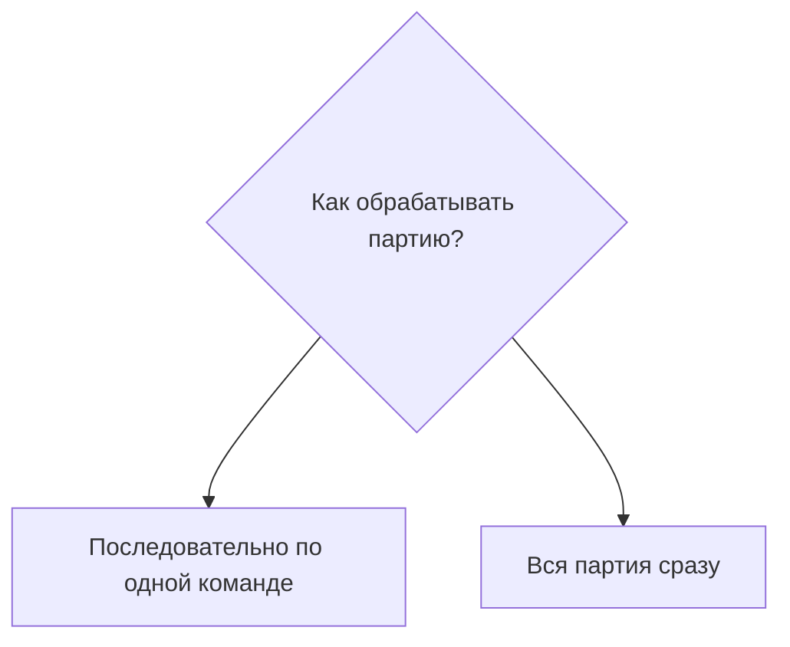

# Специализированные контейнеры

[К графу фич](../../README.md) · [Вопросы этой фичи](#открытые-вопросы)

**Статус:** исходный замысел; набор типов и бонусы ещё обсуждаются.

## Назначение

Специализированный контейнер принимает ограниченный набор предметов и вмещает существенно больше вещей. Выигрыш во вместимости компенсирует более узкое назначение. Базовое удобство поиска и получения сохраняется.

## Сценарий использования

**Исходный замысел.** Игрок выбирает контейнер под определённый запас, например материалы, и использует его как обычный контейнер мода. За ограниченный набор принимаемых предметов получает большую вместимость. Поиск и получение доступны через единое меню.

Набор типов и точные бонусы не выбраны. Особенности работы с генами описаны внутри соответствующего варианта.

## Правила работы

### Используемые правила

Используются [базовая модель контейнера](../container/README.md), его [меню](../storage-menu/container.md), [модель вместимости](../container/README.md#вместимость) и связанные фичи. Специализация описывает свои ограничения и бонусы; исключения из базовых правил должны быть явно названы.

### Предложения и риски

Слишком много узких разновидностей снова заставят игрока сортировать коллекцию контейнеров и искать нужный. Предложение — начать с небольшого числа понятных специализаций, выбранных по игровым сценариям.

## Состав и варианты

### Намеченные варианты

| Вариант | Замысел | Статус |
| --- | --- | --- |
| Материалы | Принимать материалы и давать больший запас | Пример автора; точный состав категорий не выбран |
| Руды | Хранить руды с выигрышем во вместимости | Пример автора; отличие от материалов ещё обсуждается |
| Медицинский | Принимать медицинские предметы | Используется как пример в обсуждении сортировки; состав не утверждён |
| [Гены](#контейнер-для-генов) | Удобная коллекция генетических материалов | Отдельный исходный замысел автора |

### Контейнер для генов

**Исходный замысел.** Конкретный тип специализированного контейнера; отдельного узла в графе нет.

#### Назначение

Упростить хранение большой коллекции генетических материалов и поиск нужного экземпляра. Различия образцов должны оставаться видимыми, чтобы список не превращался в свалку одинаковых названий.

#### Отличия от базового контейнера

**Исходный замысел.** Хранилище для генов в виде научной стойки или набора колб. Конкретная вместимость, принимаемые предметы и внешний вид ещё не выбраны.

Наследуются [меню](../storage-menu/container.md), [модель вместимости](../container/README.md#вместимость), [перенос](../container/README.md#помещение-и-извлечение-предметов) и [правила размещения](../container/README.md#фильтры).

**Принято для группировки.** Используем общую [ванильную совместимость стека](../storage-menu/grouping.md). Собственное объединение по типу гена, чистоте или полному совпадению свойств не вводим. Конкретные ванильные условия проверяются при реализации.

#### Предложения по UI

Показывать значимые характеристики отдельных образцов, в том числе сведения, помогающие различать их качество и состояние. Точный набор полей выбирается при проработке UI. Объединение разных экземпляров только по названию скрывало бы различия и не соответствует выбранному правилу группировки.

#### Открытые вопросы

- Какие генетические материалы принимаются и какие свойства показываются?
- Как подобрать вместимость и развитие по грейдам?
- Как отличать внешне похожие строки, не перегружая список?
- Как контейнер взаимодействует с аналитическим столом? Сценарий обработки описан ниже, внутри этого типа контейнера.

#### Пакетное исследование генов

Возможность контейнера для генов: поместить его в аналитический стол и запустить обработку содержимого. Режим обработки ещё не выбран.

##### Назначение

Сократить повторяющиеся действия врача при обработке коллекции, сохранив возможность выбрать понятный режим работы с партией.

##### Исходный замысел

Поместить [контейнер для генов](#контейнер-для-генов) в аналитический стол и исследовать содержимое за один запуск вместо ручного помещения каждого образца. Допустимость такого помещения — особенность этой функции, которую ещё нужно спроектировать.

##### Предложения и риски

Есть два варианта: последовательная обработка образцов по одной команде или одновременный результат всей партии. Решение не принято. Мгновенная обработка может изменить темп игры и ценность исследования.

Массовая обработка должна сокращать повторяющиеся действия; сохранение или изменение времени, затрат и требований нужно согласовать отдельно. Удобная коллекция сама по себе не определяет скорость исследования.

##### Варианты обработки

Это альтернативы поведения контейнера при исследовании образцов. Режим пока не выбран.

##### Открытые вопросы

- Что означает «за раз»: последовательность или одновременный результат?
- Какие генетические операции входят в функцию?
- Как сохраняются затраты, длительность и требования обычной обработки?
- Как процесс прерывается и куда попадает результат?
- Что делать при отсутствии места для результатов? [Обычный перенос запаса](../container/README.md#помещение-и-извлечение-предметов) сам по себе не определяет поведение генерации и обработки.

##### Связанные правила

[Группировка](../storage-menu/grouping.md) помогает выбрать образцы. [Правила переноса](../container/README.md#помещение-и-извлечение-предметов) описывают перемещение существующих вещей; особые результаты аналитического стола требуют собственного сценария.

## Связи с другими фичами

<!-- dependencies:start -->
### Родители

| Родитель | Что используется |
| --- | --- |
| [Контейнеры мода](../container/README.md) | Использует базовую модель размещения и хранения. Предлагает большую вместимость за ограниченный набор предметов. Перемещение образцов соблюдает общие правила; результаты исследования требуют отдельного решения. |
| [Единое меню хранения](../storage-menu/README.md) | Использует общее меню и его группировку по ванильной совместимости стека; сведения об образцах генов уточняются для конкретного типа. |

**Дочерние фичи:** пока не выделены.
<!-- dependencies:end -->

## Открытые вопросы

- Какие специализации действительно нужны и какие предметы они принимают?
- Насколько возрастает вместимость, как она связана с грейдом?
- Получает ли универсальный контейнер бонус от ручного ограничения фильтра? Это может обесценить специализированные рецепты.
- Нужны ли особые контейнеры со слотами для других контейнеров? Такая возможность допускается как исключение, но конкретные варианты пока не выбраны.

[Грейды](../progression/README.md) — отдельная фича: специализация задаёт назначение, улучшение — развитие конкретного контейнера. Точная связь с качеством пока открыта.

Вопросы конкретного типа и его обработки остаются в разделе [контейнера для генов](#контейнер-для-генов), включая [пакетное исследование](#пакетное-исследование-генов).
