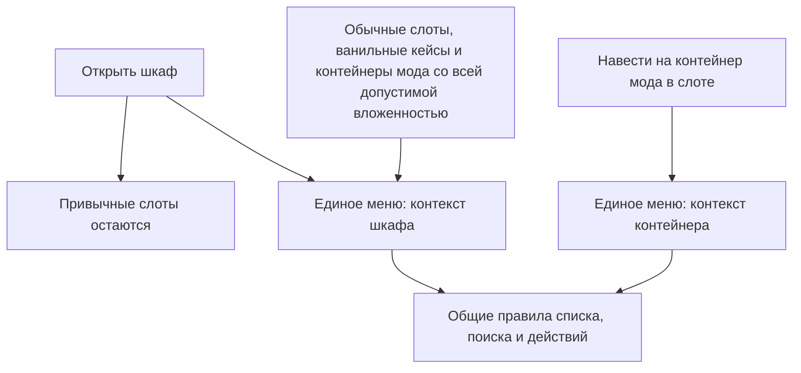

# Единое меню хранения

[К графу фич](../../README.md) · [Вопросы этой фичи](#открытые-вопросы)

**Статус:** единая фича, два контекста использования и включение группировки приняты. Основные правила списка и доступа согласованы; детали управления и оформления обсуждаются.

## Назначение

Дать игроку единый способ видеть запас, искать, помещать и получать предметы. Меню работает с ванильными шкафами и кейсами и с контейнерами нашего мода. Для работы общего меню шкафа контейнеры мода не нужны.

Меню шкафа и всплывающее меню контейнера — два контекста одной фичи. Они используют общие правила списка и взаимодействия, но могут отличаться областью обзора, расположением и доступными действиями.

## Сценарий использования

**На основе принятых правил.**

1. Игрок открывает шкаф и видит привычные слоты вместе с боковым общим списком.
2. Находит нужные предметы через поиск и получает допустимое количество из реальных мест хранения.
3. Для работы с отдельным контейнером мода наводит на него указатель в слоте: открывается всплывающее меню его запаса.

Общие правила действуют в обоих контекстах. Конкретные команды помещения и извлечения, выбор количества и источника ещё обсуждаются.

## Подробное описание

| Тема | Что описано |
| --- | --- |
| [Общие правила взаимодействия](interaction.md) | Требования к хранилищу, поиск и действия, граница ответственности меню и контейнера, предложения по управлению |
| [Группировка предметов](grouping.md) | Ванильная совместимость, количество в строке, сохранность экземпляров, примеры и схема |
| [Меню шкафа](cabinet.md) | Боковая панель, область общего списка, суммарный счётчик, распределение запаса и подсветка |
| [Меню контейнера](container.md) | Интерактивное окно по наведению, собственный счётчик, поведение окна и доступ вне шкафа |

## Контексты меню

| | [Шкаф](cabinet.md) | [Отдельный контейнер](container.md) |
| --- | --- | --- |
| Область списка | Предметы шкафа и всё допустимое вложенное содержимое | Выбранный контейнер и его допустимое вложенное содержимое |
| Открытие | Боковая панель при открытии шкафа | Всплывающее интерактивное окно при наведении на контейнер мода в слоте |
| Вместимость наших контейнеров | Суммарный счётчик с детализацией | Собственный счётчик |
| Особенности | Распределение запаса по местам хранения; дополнительные действия над шкафом | Действия над выбранным контейнером |
| Предложенная подсветка | Подсветить контейнеры с ресурсом при наведении на него в списке | Для непосредственного содержимого одного контейнера не требуется |

### Схема доступа

Стрелки показывают доступ к интерфейсу, а не зависимости фич или технический алгоритм.

## Связи с другими фичами

<!-- dependencies:start -->
### Родители

| Родитель | Что используется |
| --- | --- |
| [Фундамент](../../foundation.md) | Сохраняет привычные слоты и даёт единый способ видеть запас и работать с ним. Работает на ванильных хранилищах без контейнеров мода. |

**Дочерние фичи:** [Контейнеры мода](../container/README.md), [Специализированные контейнеры](../specializations/README.md)
<!-- dependencies:end -->

Граница ответственности подробно описана в [общих правилах взаимодействия](interaction.md#граница-между-меню-и-контейнером).

- [Контейнеры мода](../container/README.md): хранение, вместимость, приём и выдача, фильтры.
- [Специализированные контейнеры](../specializations/README.md): особенности конкретных типов.
- [Автосортировка](../automation/README.md): опциональный выбор мест хранения и перемещение.
- [Поиск по подлодке](../submarine-search/README.md): отдельная область поиска, выходящая за пределы локального меню.

## Открытые вопросы

Вопросы находятся рядом с соответствующими правилами:

- [Управление действиями и дополнительные кнопки](interaction.md#открытые-вопросы).
- [Выбор источника и экземпляра, проверка совместимости и обновление строк](grouping.md#открытые-вопросы).
- [Панель шкафа, ограничения рядом со счётчиком и подсветка](cabinet.md#открытые-вопросы).
- [Поведение всплывающего окна и открытие вне шкафа](container.md#открытые-вопросы).
