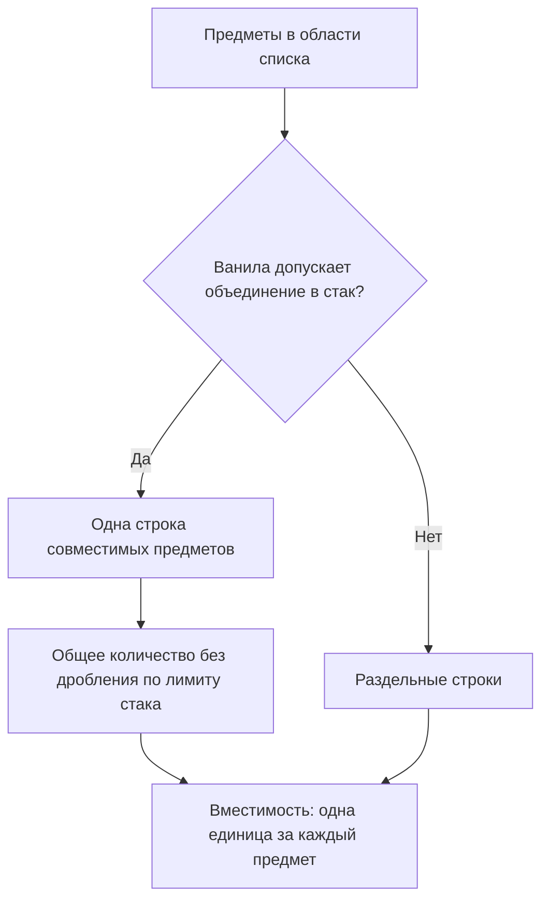

# Группировка предметов

[К обзору фичи](README.md)

**Статус:** правило группировки принято; способ проверки ванильной совместимости и детали UI уточняются при реализации.

Группировка — правило представления списка внутри единого меню, а не самостоятельная фича. Стак — группа предметов в одном ванильном слоте; строка списка — представление совместимых предметов из области меню. Экземпляр — конкретный предмет со своими свойствами.

## Правило группировки

**Принято 20 октября 2026 года.** Строки в меню контейнера и общем меню шкафа формируются по ванильным правилам совместимости предметов для объединения в стак.

- Предметы, которые ванила разрешает объединять в стак, показываются одной строкой с общим количеством.
- Предметы, которые ванила не разрешает объединять, показываются разными строками.
- Нестакуемое оборудование отображается поштучно, даже если два экземпляра внешне одинаковы.
- Собственное сравнение всех свойств, модулей и содержимого вложенных слотов для поиска «полностью идентичных» экземпляров не вводится.

Это сохраняет привычный принцип игры и не требует заранее перечислять все возможные различия предметов.

## Совместимость и размер стака

Правила совместимости определяют, какие экземпляры могут находиться в одной строке. Численный предел размера ванильного стака не делит совместимый запас на несколько строк списка: например, 54 совместимые единицы алюминия показываются как «Алюминий — 54».

Нестакуемость предмета сохраняется. Отказ от численного предела строки не разрешает объединять предметы, которые ванила считает нестакуемыми.

В контейнерах нашего мода каждый предмет по-прежнему занимает одну единицу [вместимости](../container/README.md#вместимость). При получении вещей в обычный инвентарь применяются правила его слотов и размеров стаков. Если партия не помещается целиком, переносится доступная часть, остальное остаётся в источнике. См. [правила переноса](../container/README.md#перенос-при-нехватке-места).

## Отображение и сохранность

Группировка меняет представление запаса. Каждый экземпляр сохраняет своё состояние и содержимое; объединение в строку не усредняет свойства и не заменяет предметы типовым экземпляром.

Примеры принципа:

| Ситуация | Отображение |
| --- | --- |
| Несколько экземпляров, совместимых для ванильного стака | Одна строка с количеством |
| Использованный экземпляр несовместим с группой новых по правилам игры | Отдельная строка |
| Два экземпляра нестакуемого оборудования | Две строки |
| Различающиеся варианты, которые игра не объединяет | Разные строки, без общей свёрнутой группы |

Не требуется описывать в интерфейсе все свойства для того, чтобы сформировать строки. Какие сведения показывать рядом с названием, а какие в подсказке, решается на этапе UI. Оснащение, содержимое слотов и характеристики генов могут помогать выбирать предмет.

## Схема группировки

Схема отражает правило представления, а не алгоритм или выбранный API игры.

## Открытые вопросы

На этапе реализации и UI:

- Определить, как использовать ванильную проверку совместимости отдельно от численного ограничения стака.
- Проверить реальные правила игры для топлива, оборудования, предметов с содержимым и генов.
- Определить обновление строк при изменении состояния предметов, чтобы интерфейс оставался удобным.
- Как выбирать источник из общей строки, если совместимые предметы распределены по нескольким местам?
- Какие свойства показывать в строке и подсказке, чтобы различать экземпляры?

Общие предложения по выбору количества, экземпляра и показу результата переноса — в [правилах взаимодействия](interaction.md#общие-предложения-по-ui).
